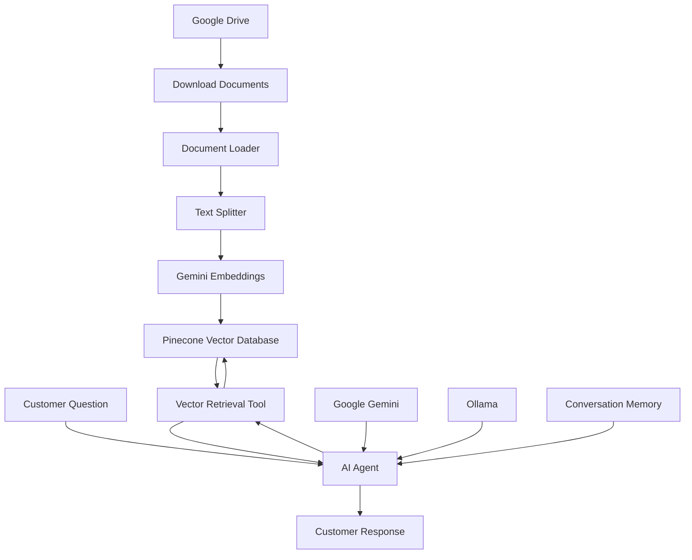

# Aetherflow AI Knowledge Base & RAG Customer Support Assistant

An AI-powered customer support and knowledge retrieval system built using Retrieval-Augmented Generation (RAG), n8n, Google Gemini, Pinecone, Google Drive, and Ollama.

## Project Overview

Aetherflow AI Knowledge Base is designed to help businesses automate customer support and retrieve relevant information from company documents using natural-language questions.

The system processes company documents, generates vector embeddings, stores them in a vector database, and retrieves relevant information to generate context-aware responses.

This project demonstrates the practical implementation of Retrieval-Augmented Generation, AI agents, vector databases, and intelligent workflow automation.

## Business Problems Addressed

- Time-consuming manual searches through company documents.
- Repetitive customer support inquiries.
- Inconsistent responses to customer questions.
- Difficulty accessing relevant company policies and procedures.
- AI-generated responses that are not grounded in company information.

## Key Features

- Automated document ingestion from Google Drive.
- Document processing and recursive text splitting.
- Vector embedding generation using Google Gemini.
- Vector storage and semantic retrieval using Pinecone.
- AI-powered customer support assistant.
- Natural-language question answering.
- Conversation memory for contextual interactions.
- Google Gemini and Ollama language model integration.
- Multiple-question handling instructions.
- Fallback response for insufficient information.
- Prompt-based controls designed to reduce hallucinations.

## Technology Stack

| Technology | Purpose |
|---|---|
| n8n | Workflow automation and orchestration |
| Google Drive | Company document storage |
| Google Gemini | AI language model and vector embeddings |
| Pinecone | Vector database and semantic search |
| Ollama | Local language model integration |
| Qwen 2.5 1.5B | Local AI model |
| Recursive Character Text Splitter | Document chunking |
| Simple Memory | Conversation context |
| Docker Desktop | Local deployment environment |

## System Architecture

### Phase 1: Document Ingestion

1. Retrieve company documents from Google Drive.
2. Download the selected documents.
3. Process documents using the Default Data Loader.
4. Split document content into smaller chunks.
5. Generate vector embeddings using Google Gemini.
6. Store the embeddings in Pinecone.

### Phase 2: AI Knowledge Retrieval

1. Receive a customer question through the n8n Chat Trigger.
2. Process the question using the AI Agent.
3. Search the Pinecone vector database for relevant information.
4. Retrieve relevant company knowledge.
5. Generate a context-aware response.
6. Return the response to the customer.

### Workflow Architecture

## Hallucination Reduction Strategy

The AI Agent is instructed to:

- Retrieve company information before answering.
- Use relevant information from the knowledge base.
- Avoid inventing company policies, prices, or procedures.
- Address multiple customer questions individually.
- Return a fallback response when sufficient information is unavailable.

Expected fallback response:

> Can't find useful information

These instructions are designed to reduce unsupported responses but do not guarantee complete hallucination prevention.

## Potential Business Applications

- AI customer support assistants.
- Internal company knowledge bases.
- Employee onboarding assistants.
- Product and service information assistants.
- Company policy retrieval systems.
- Automated FAQ assistants.
- Technical support knowledge retrieval.

## Project Screenshots

Workflow architecture, document ingestion, AI retrieval, and customer support demonstrations are available in the [screenshots folder](./screenshots).

## Workflow File

The sanitized n8n workflow is available here:

[Download n8n RAG Workflow](./aetherflow-rag-workflow-public.json)

## Installation and Configuration

1. Install and configure n8n.
2. Download the workflow JSON from this repository.
3. Import the workflow into n8n.
4. Configure your Google Drive credentials.
5. Configure your Google Gemini API credentials.
6. Configure your Pinecone account and vector index.
7. Install and configure Ollama.
8. Download the Qwen 2.5 1.5B model.
9. Configure your company document folder.
10. Execute the document ingestion workflow.
11. Test the AI assistant using the chat interface.

## Security and Privacy

The publicly shared workflow has been sanitized to remove credential references and private configuration identifiers.

Users must configure their own credentials, document sources, and vector database.

## Project Status and Limitations

This project was developed as a practical AI automation training and portfolio project.

It demonstrates RAG architecture, document ingestion, vector retrieval, AI agent orchestration, and conversational customer support.

The separate file-type routing branch is experimental and is not integrated into the main ingestion pipeline.

Additional security controls, retrieval evaluation, monitoring, and production testing would be required before commercial deployment.

## Skills Demonstrated

- AI Automation Engineering
- Retrieval-Augmented Generation (RAG)
- AI Agent Development
- Prompt Engineering
- Vector Database Integration
- Semantic Search
- Document Processing
- Workflow Automation
- API Integration
- Local Language Model Integration
- Knowledge Base Development
- Business Process Automation

## Author

Ajise Sunday Jeremiah

AI Automation Developer | AI Workflow Developer | IT Specialist
